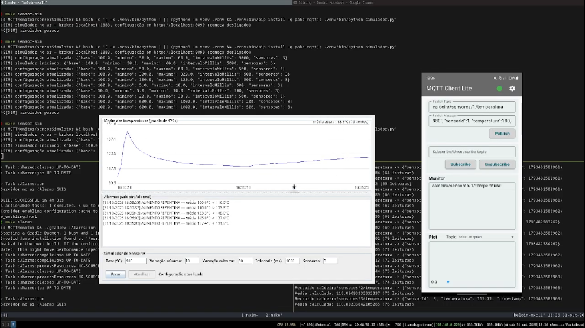

# codigosSD

Códigos dos projetos de Sistemas Distribuídos (PPCSD).

## Projetos

- **JavaServerSocket_Calculadora / JavaClientSocket_Calculadora** — calculadora via sockets TCP. Servidor com thread por cliente; cliente CLI com menu e expressões matemáticas (com parênteses) decompostas em operações básicas ou calculadas inteiras no servidor.
- **ExemploRMI** — calculadora via RMI Java (Registry na porta 1099). Interface `ICalculadora` com as quatro operações e avaliação de expressões.
- **rpcKTOR** — calculadora via RPC em JSON sobre HTTP (Ktor + Kotlin). Cliente tipado via interface; servidor responde `{"result": ...}` ou `{"error": ...}`.
- **ClientHTTPSCalculadora** — cliente Swing que conversa com o servidor PHP local (mesma API REST de `/operation/{op}/{a}/{b}`), com exponential backoff de 4 retentativas e caixa de log.
- **calculadoraPHP** — calculadora em PHP servida por HTTP (rota `/operation/...`), com formulário HTML e endpoint JSON. `make server-php` roda o servidor com toggle de bloqueio (tecla B retorna 500).
- **MQTTMonitor** — monitoramento de uma caldeira via MQTT (broker Mosquitto no Docker): serviço CAT calcula a média das temperaturas dos últimos 120s e publica eventos; serviço Alarms é o painel GUI (gráfico da média, log de alarmes e controle do simulador); **sensorSimulator** simula os sensores em Python, configurável em runtime.
- **Avaliador de expressões** (`shared/Avaliador.java`, usado nos projetos de socket e RMI) — tokenizer + shunting-yard para as expressões com parênteses.

## Relatório (AT03)

[`relatorio_AT03_final.pdf`](relatorio_AT03_final.pdf) — *Invocação Remota e Comunicação Indireta: uma comparação experimental entre Socket, RMI, JSON-RPC, HTTP/REST e MQTT* (CKP7500 – Sistemas Distribuídos, MDCC/UFC).

O tráfego de cada implementação foi capturado no Wireshark executando as mesmas operações. Cada modelo concentra seu custo em um ponto diferente:

- **Socket** — controle total, mas um segmento por caractere: 78 pacotes para 76 bytes de dados.
- **RMI** — chamada transparente com tipagem forte, mas 41% dos pacotes são controle do middleware (registry, DGC, reconexões); restrito à JVM.
- **JSON-RPC** — tudo legível em JSON, porém 75% dos bytes trafegados são cabeçalho HTTP.
- **HTTP/REST** — uma conexão TCP por requisição; o retry com exponential backoff (1, 2, 4, 8 s) tolera quedas de até ~15 s em operações idempotentes.
- **MQTT** — cabeçalho de 2 bytes e desacoplamento espacial (sensores não conhecem os serviços), em troca de 8 PUBLISH por leitura, pois tudo passa pelo broker.

## Demonstração MQTT

